<div align="center">


# cardsdotgg

**Yield-funded card battles on NEAR. Deposit, build a deck, open packs, and duel turn by turn with every move recorded onchain.**

[](https://testnet.nearblocks.io/address/9cc71b1795d97d7afedcf6ca6863a9134b9adb117301f79d84424d5471daf0f4)
[](near)
[](app)
[](#where-rhea-data-is-used)
[](#known-limits)

[App tour](#app-tour) · [How it works](#how-it-works) · [Game rules](#game-rules) · [Architecture](#architecture) · [Quick start](#quick-start) · [Known limits](#known-limits)

</div>

> Test tokens have no real value. The contracts are unaudited prototypes on NEAR testnet.

## Table of contents

- [Overview](#overview)
- [App tour](#app-tour)
- [How it works](#how-it-works)
- [Game rules](#game-rules)
- [Architecture](#architecture)
- [Live contracts](#live-contracts-near-testnet)
- [Quick start](#quick-start)
- [Deploy to NEAR testnet](#deploy-to-near-testnet)
- [Where Rhea data is used](#where-rhea-data-is-used)
- [Project layout](#project-layout)
- [Testing](#testing)
- [Known limits](#known-limits)
- [Credits](#credits)

## Overview

cardsdotgg is a trading-card battler where your deck is a DeFi position. You put test tokens into a vault and get a deck. The deck earns yield at rates taken from real [Rhea](https://rhea.finance) pools, and that yield, never your principal, is what you stake in matches. Two players then duel turn by turn, and each move, the winner, the stakes and the ratings are settled by a NEAR smart contract.

- **A deck is a vault position.** Pick Guardian (steady), Balanced or Degen (risky). Principal never moves in a match.
- **24 original creatures with real abilities.** Stats and abilities come from the product spec in [`cardsdotgg.md`](cardsdotgg.md).
- **Collect and customize.** Packs unlock more creatures and pictures. Rare pictures give a small HP perk. Ownership is checked by the contract.
- **Play without signing every move.** Matchmaking adds a restricted "quick play" key, so a duel has no wallet pop-ups.
- **Practice for free.** Practice plays the same rules against the computer, with your own saved deck, and sends nothing to the chain.

> **Status:** deployed on NEAR testnet and exercised end to end (claim, deposit, seed, challenge, accept, resolve, replay, withdraw), plus a full turn-based duel with session keys only (`pnpm e2e:duel`) and a pack purchase with ownership checks (`pnpm e2e:packs`).

## App tour

Screens are shown at phone size with sample data. The app is built phone-first and also works on a laptop.

### Play

<table>
<tr>
<td width="25%">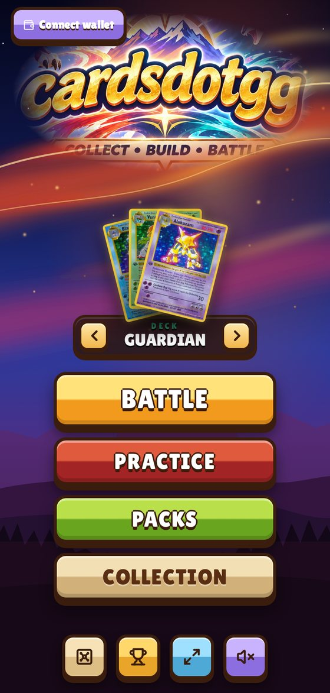</td>
<td width="25%">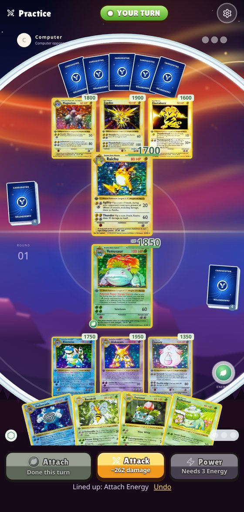</td>
<td width="25%">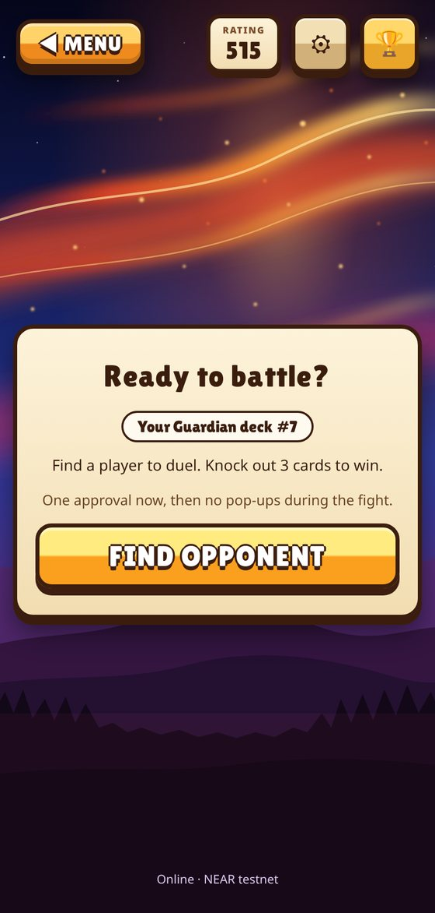</td>
<td width="25%">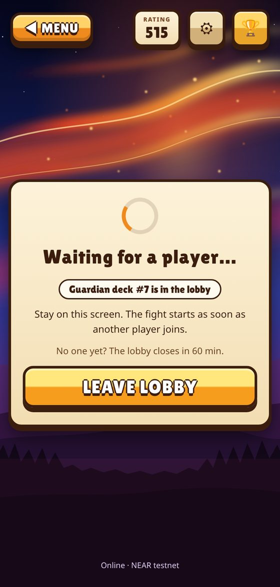</td>
</tr>
<tr>
<td valign="top"><b>Main menu.</b> Pick a deck type, then BATTLE (online), PRACTICE, PACKS or COLLECTION. Signing in is only needed for online play.</td>
<td valign="top"><b>Practice.</b> The real duel rules against the computer. Uses your saved deck when you are signed in, otherwise the starter deck. Nothing is sent to the chain.</td>
<td valign="top"><b>Lobby.</b> Shows the deck you will bring. FIND OPPONENT asks your wallet once and turns on quick play. Rating, Settings and the leaderboard sit at the top.</td>
<td valign="top"><b>Waiting.</b> Your deck is in the lobby. The fight starts the moment another player joins. Leave any time.</td>
</tr>
</table>

<table>
<tr>
<td width="25%">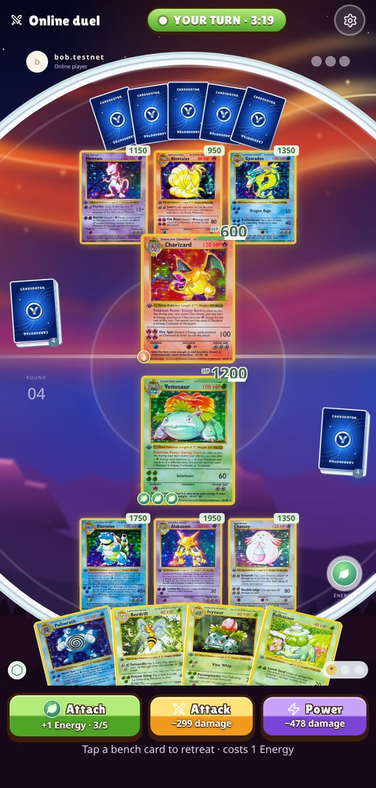</td>
<td width="25%">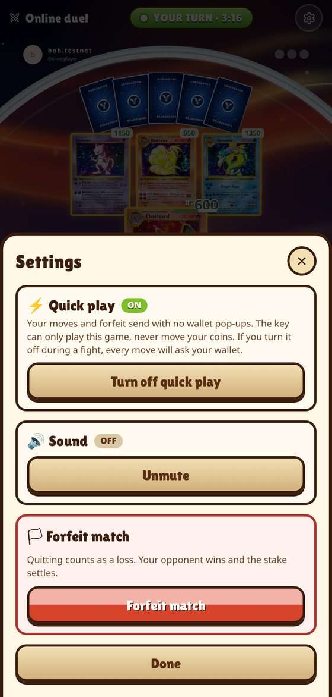</td>
<td width="25%">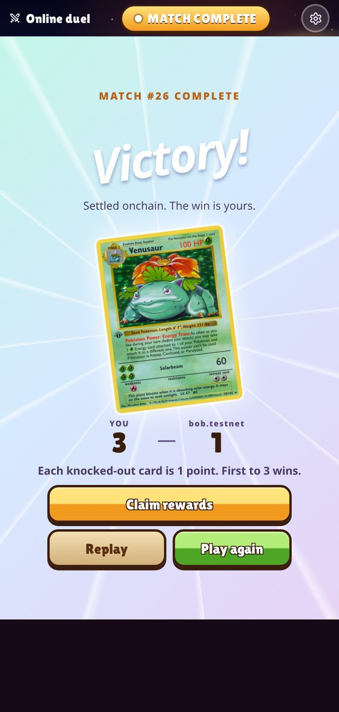</td>
<td width="25%">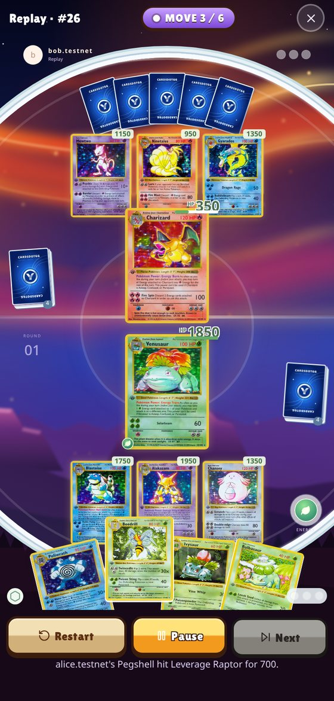</td>
</tr>
<tr>
<td valign="top"><b>The duel.</b> Your active card in the middle, bench below, hand at the bottom. Attach, Attack and Power show what they do or why they are locked. A whole turn is one transaction.</td>
<td valign="top"><b>Settings.</b> Turn quick play on or off, mute sound, or forfeit. The only place these controls live.</td>
<td valign="top"><b>Result.</b> Labelled score, then Claim rewards (collects yield and ends quick play), Replay, or Play again.</td>
<td valign="top"><b>Replay.</b> Watch the match back on the same board with the same cinematics: Play, Pause, Next, Restart.</td>
</tr>
</table>

### Build

<table>
<tr>
<td width="33%">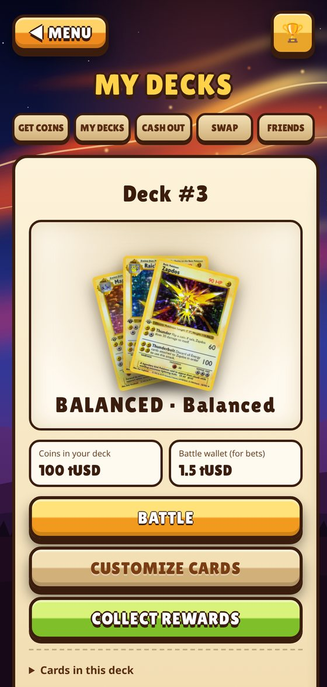</td>
<td width="33%">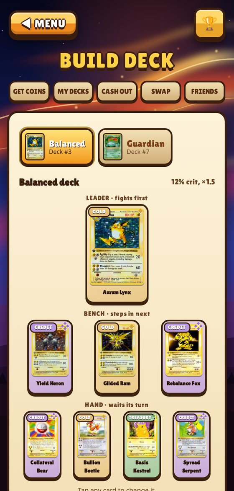</td>
<td width="33%">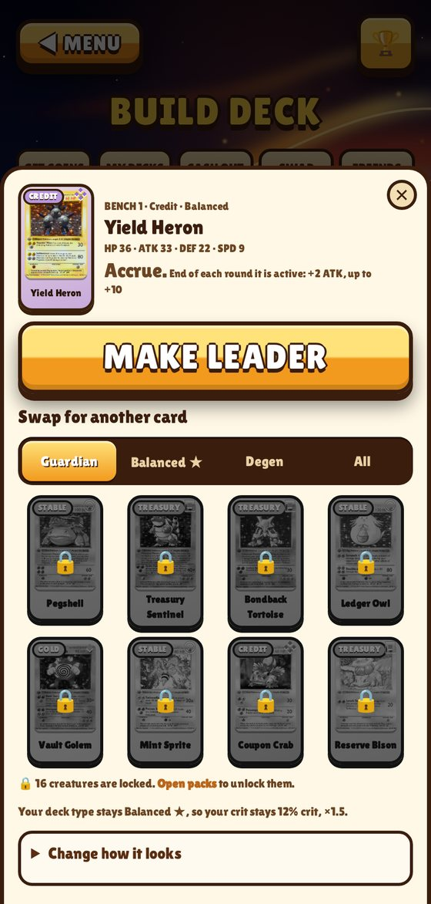</td>
</tr>
<tr>
<td valign="top"><b>My Decks.</b> A swipeable carousel, one deck per slide, with its coins, battle wallet, and the BATTLE, CUSTOMIZE CARDS and COLLECT REWARDS buttons at one size.</td>
<td valign="top"><b>Deck builder.</b> The deck laid out as it plays: one Leader, three Bench, four Hand. Each card appears once. Tap any card to change it.</td>
<td valign="top"><b>Card sheet.</b> Make it leader, swap it for another card (locked creatures show a padlock), or change how it looks. Save appears only when something changed.</td>
</tr>
</table>

### Collect

<table>
<tr>
<td width="33%">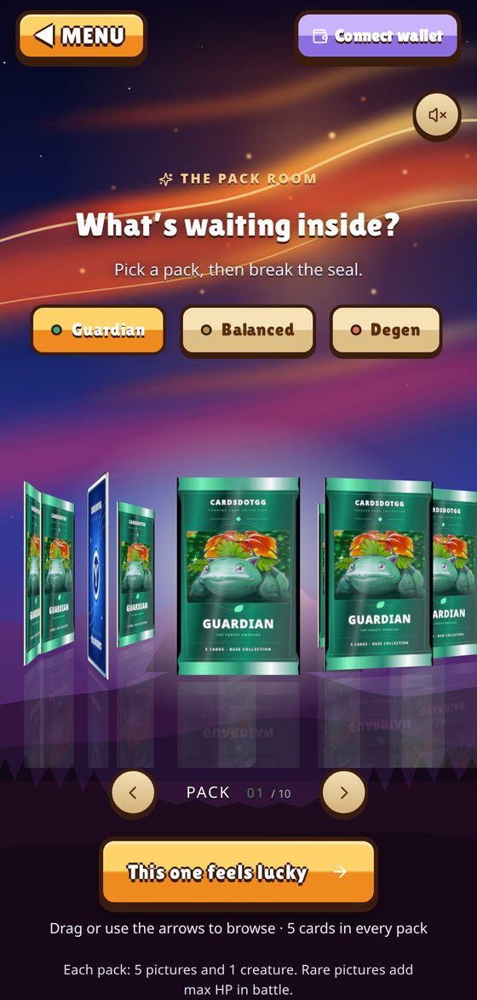</td>
<td width="33%">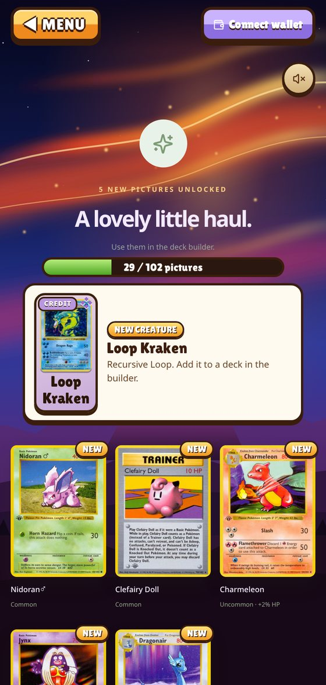</td>
<td width="33%" valign="top">
<b>Packs.</b> A pack costs 2 tUSD and holds 5 pictures and 1 creature. Opening one is a real purchase, then a reveal one card at a time. The summary marks what is NEW, shows each picture's HP perk, any creature you unlocked, and an unlocked counter.<br /><br />
<b>Collection.</b> Search all 102 pictures. Each is marked Starter, Unlocked (with its perk) or Locked.
</td>
</tr>
</table>

Other screens: **Get Coins** (claim free test tokens and make a deck), **Cash Out** (withdraw), **Swap** (the tUSD/tNEAR pool), **Friends** (challenge a named account) and the **Leaderboard**.

## How it works

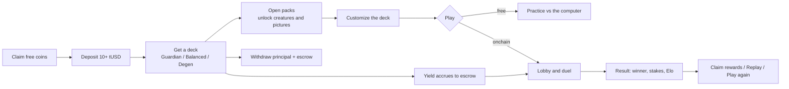

1. **Claim and deposit.** Claim tUSD or tNEAR once per 24 hours, then deposit at least 10 tUSD of value (tNEAR is valued at the Rhea-derived price) to mint a deck. A deposit is one `ft_transfer_call`: no approve step.
2. **Earn.** Yield accrues to the deck's escrow in tUSD at the oracle rate, paid from a reserve the owner funded. Collect it any time from My Decks.
3. **Open packs.** Each pack is 2 tUSD sent to the game contract. It unlocks 5 pictures and 1 creature in your onchain collection. See [Packs and perks](#packs-and-perks).
4. **Customize.** In the deck builder pick 8 different creatures and a picture for each. The contract refuses a creature or picture you have not unlocked.
5. **Practice (optional).** Play the computer with your deck to test it. Free, and no wallet needed.
6. **Battle.** Tap FIND OPPONENT to open a lobby, or JOIN BATTLE on one that is waiting. Each player stakes 0.1% of their deposit from escrow. If either side is short, the match is Rank-only.
7. **Duel.** Players alternate turns. A turn is a few moves (attach Energy, retreat) and an attack, sent as one transaction. The duel ends at 3 knockouts, a forfeit, or after 5 minutes of silence.
8. **Settle.** In the transaction that ends the duel, the contract records the winner, pays the winner 95% of the loser's stake (5% to the prize pool) and updates Elo (start 500, K=32).
9. **Review.** Claim rewards, watch the Replay, or Play again.
10. **Withdraw.** A full withdraw retires the deck and pays principal plus remaining escrow, in tUSD or tNEAR at the oracle price.

The **Swap** page is a separate tUSD/tNEAR constant-product pool (0.3% fee that stays in the reserves). Swaps are one signature: `ft_transfer_call` with `{"action":"swap","min_out":...}` and the output is paid straight to the wallet. Adding liquidity sends both tokens in one wallet approval. Remove and withdraw is one transaction.

### Quick play (no pop-up per move)

Signing every move would be unplayable, so matchmaking sets up a session key.

- **One approval.** `FIND OPPONENT` and `JOIN BATTLE` ask the wallet once. That approval also adds a restricted function-call key to your account.
- **A boxed-in key.** The chain limits it to the game contract and to `play_turn`, `play`, `forfeit` and `claim_timeout`, with no deposit and a 0.25 NEAR gas allowance. It cannot move coins, withdraw or change a deck. A whole match used about 0.002 NEAR of its allowance.
- **No pop-ups.** The app signs moves with the key, in the browser. If the key is revoked or used up, it falls back to the wallet.
- **You stay in control.** Settings turns it off (removes the key). Claim rewards on the result screen collects yield and ends it. The key lives in the browser's localStorage.

If a wallet cannot read the bundled add-key or remove-key approval, the app stops bundling and plays on with normal approvals. Before it retries a call it checks the chain, so a join or a search is never sent twice.

### Wallet signatures

The app bundles where NEAR allows it: several actions to one contract share one transaction, and several transactions share one wallet approval (`signAndSendTransactions`). Claim both tokens is 1 approval, a first-time tNEAR withdraw is 1, a pool swap is 1, adding liquidity is 1, remove + withdraw is 1. Transfers that attach the 1 yoctoNEAR deposit always prompt the wallet.

## Game rules

The duel rules live in [`near/game/src/duel.rs`](near/game/src/duel.rs) and are ported line for line to [`app/lib/game/duelEngine.ts`](app/lib/game/duelEngine.ts), so practice plays by the same rules. They build on the spec engine in [`cardsdotgg.md`](cardsdotgg.md) and [`shared/engine-rules.md`](shared/engine-rules.md).

| | |
| --- | --- |
| **Board** | 8 cards per side: 1 active, 3 on the bench, 4 in hand. A knockout promotes the first bench card and refills the bench from the hand. |
| **Who goes first** | The higher SPD. Ape Comet always leads, Basis Kestrel borrows a faster enemy's SPD, ties roll. |
| **Your turn** | Attach 1 Energy (once). Retreat to a bench card (once, costs 1 Energy). Then attack, which ends the turn. |
| **Attacks** | A basic attack needs 1 Energy. A power attack needs 3. Energy caps at 5. |
| **Damage** | The spec formula `ATK*1000/(50+DEF)`, then +15% per Energy, power x1.6, the class wheel (x1.25 strong, x0.8 weak), 90-110% variance, tier crit, then abilities. |
| **Crit** | By deck type: Guardian 5% x1.3, Balanced 12% x1.5, Degen 25% x1.8. |
| **Abilities** | All 24 from the spec. "Each round" abilities fire once per owner turn. |
| **Win** | 3 knockouts, or the other side runs out of cards. A forfeit or 5 minutes of silence also loses. |

The class wheel is Stable > Treasury > Gold > Credit > BTC > Stable. The class wheel and the Energy, power and retreat numbers are new to this build and need playtesting.

### Packs and perks

- A pack is **2 tUSD**: 2 common, 2 uncommon and 1 rare picture, plus 1 creature.
- **Creatures:** a deck can always use its own type's 8 starter creatures. Any other creature must be unlocked.
- **Pictures:** a card's picture must be one of the 24 printed on the starter decks, or unlocked. Each picture can be used once per deck.
- **HP perk:** a picture unlocked from a pack adds max HP to its card, rare +5% and uncommon +2%. Starter pictures and the default give nothing.

## Architecture

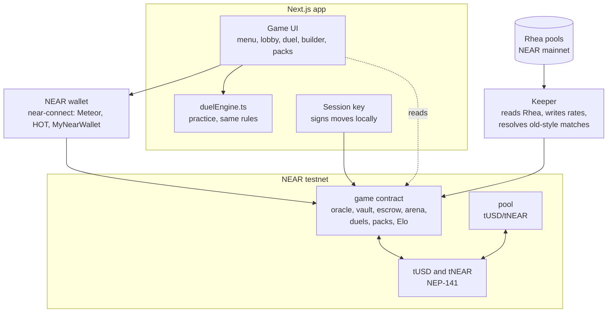

| Part | What it does |
| --- | --- |
| **`near/game`** | One contract: rate oracle, deck vault, yield escrow, arena, Elo, onchain deck SVG, the auto-battle engine (a port of the Solidity engine), turn-based duels (`duel.rs`) and packs (`collection.rs`). It lives on one account because NEAR calls between contracts are asynchronous and the state must change together. |
| **`near/ft`** | A NEP-141 test token with a 24h `claim`. Deployed twice, as tUSD and tNEAR. |
| **`near/pool`** | The tUSD/tNEAR constant-product pool. |
| **`keeper/`** | Reads Rhea on mainnet and writes rates and the NEAR price to the game contract, resolves old-style matches, and holds the deploy and e2e scripts. |
| **`app/`** | The Next.js app: UI, the local practice engine, wallet and session-key code. |
| **`shared/`** | Card data, engine rulings, Rhea snapshots, addresses. |

**Game contract methods**

| Area | Methods |
| --- | --- |
| Vault | `ft_on_transfer` (`deposit`, `reserve`, `liquidity`, `pack`), `checkpoint`, `withdraw`, `quote_withdraw`, `seed_escrow` |
| Oracle | `set_rates`, `reset_rates`, `set_near_price`, `oracle` |
| Duels | `create_challenge`, `accept_duel`, `play`, `play_turn`, `forfeit`, `claim_timeout`, `cancel`, `expire`, `get_duel`, `get_match`, `recent_matches` |
| Auto-battle | `accept`, `resolve`, `simulate`, `simulate_with_log` |
| Decks and packs | `set_deck_cards`, `get_deck_cards`, `get_collection`, `pack_price`, `decks_of`, `deck_svg` |
| Ratings | `rating_of`, `players`, `player_count` |

Contract changes are made so existing state keeps loading: new data goes in new storage maps, and older records are still read and converted.

## Live contracts (NEAR testnet)

| Contract | Account |
| --- | --- |
| game (oracle, vault, escrow, arena, duels, packs) | `9cc71b1795d97d7afedcf6ca6863a9134b9adb117301f79d84424d5471daf0f4` |
| tUSD | `7d06f44ba61478f74028c9d8699a23e7c131f5f3379c2a311cc0a202b4bb303e` |
| tNEAR | `0614bb856676794695de6f15e98539e9d4a3763090fb7bb194e2cc0c67b9ad30` |
| pool (tUSD/tNEAR) | `d1cf94d90fecf6894df4077d1d0b7ef7a6ce59d0dc336c68bae66136df5b0cad` |

Explorer: <https://testnet.nearblocks.io>. NEAR keeps one contract per account, so the game contract lives on the owner account and the other three on implicit accounts.

NEAR needs wasm built with `--cfg near` (what `cargo near build` sets). A plain `cargo build` produces wasm whose panics have no message, so errors in the app show as a generic crash. Build with `RUSTFLAGS="--cfg near -C link-arg=-s" cargo build --target wasm32-unknown-unknown --release --workspace`.

## Quick start

**Prerequisites:** Node (v22 was used) and pnpm, Rust with the `wasm32-unknown-unknown` target, and a NEAR testnet wallet (Meteor, HOT or MyNearWallet).

```bash
pnpm install

# contracts
cd near
cargo test --workspace                     # 55 game tests
RUSTFLAGS="--cfg near -C link-arg=-s" cargo build --target wasm32-unknown-unknown --release --workspace

# app
cd ../app
pnpm dev --port 3000                       # http://localhost:3000
pnpm typecheck
pnpm test:game                             # old practice-game tests
pnpm test:duel                             # the TypeScript duel engine
NEXT_DIST_DIR=.next-test pnpm dev --port 3011   # a second dev server without touching the first one's .next

# keeper (reads Rhea on NEAR mainnet)
cd ../keeper
pnpm dry                                   # read only, writes shared/*.json
pnpm run-once                              # also writes rates and the NEAR price to the testnet game contract
```

**First run in the app:** open `/`, tap PRACTICE to play right away with no wallet. To play online, tap BATTLE, connect a wallet, then GET COINS (claim free coins, make a deck) and FIND OPPONENT. You also need a little testnet NEAR for fees, free at <https://near-faucet.io/>.

### Deploy to NEAR testnet

Needs a funded testnet account and a `.env` at the repo root (see `.env.example`). NEAR stakes about 1 NEAR per 100 KB of contract code; after wasm optimisation the four contracts are about 760 KB, so budget roughly 10 testnet NEAR. The owner account hosts the game contract. The two tokens and the pool each get a fresh implicit account funded by the script (keys go to the gitignored `keeper/.deploy-keys.json`).

```bash
cd near && RUSTFLAGS="--cfg near -C link-arg=-s" cargo build --target wasm32-unknown-unknown --release --workspace
cd ../keeper && pnpm dry
NEAR_OWNER_ID=you.testnet NEAR_OWNER_KEY=ed25519:... pnpm deploy-testnet   # deploys, funds reserve and liquidity, opens the pool
KEEPER_ACCOUNT_ID=... KEEPER_PRIVATE_KEY=... pnpm run-once                  # writes live Rhea rates and price
CODE_ONLY=1 ONLY=game pnpm deploy-testnet                                   # later: replace only the game contract's code, keeping its state
pnpm e2e                                                                    # two fresh players play a full loop
pnpm e2e:duel                                                               # a whole duel with session keys only (needs ~0.4 testnet NEAR)
pnpm e2e:packs                                                              # buy a pack, check unlocks and ownership (needs ~0.2 testnet NEAR)
pnpm resolve:watch                                                          # auto-resolve old-style matches and expire stale lobbies
bash deploy/install-resolver.sh                                             # run the resolver as a systemd user service
```

The keeper's resolver (`pnpm resolve:watch`) only matters for the older auto-battle path (`accept` then `resolve`). Duels need no resolver: the contract settles them in the final move.

## Where Rhea data is used

A one-shot keeper (`keeper/`) reads NEAR mainnet and writes `shared/rate-sources.json` and `shared/liquidity-source.json`. It runs on demand, so these are snapshots, not a live feed.

| Use | Rhea source |
| --- | --- |
| Guardian rate | Rated stable pool #4179 (USDt/USDC/USDT.e/USDC.e) |
| Balanced rate | USDC/wNEAR pool #4512 |
| Degen rate | RHEA/wNEAR pool #6458 |
| tNEAR price and pool opening depth | USDC/wNEAR pool #4512 reserves |

- **Method:** pool APY, TVL and 24h volume come from `indexer.ref.finance/proxy/pool/search`, and the keeper cross-checks the pool's tokens against `get_pool` on `v2.ref-finance.near` over RPC. The rate is Rhea's reported APY for the whole pool. It is not what any single position earned, and it ignores impermanent loss. The oracle caps rates at 50% and moves them at most 2 points per keeper run after the first.
- **No gold:** there is no gold token with a Rhea price on NEAR, so the former tGOLD asset became **tNEAR**.
- **Prices:** USDC is treated as 1 USD. The testnet pool opens at the Rhea price and total value using test tokens. It does not hold real assets, and its price moves only with its own swaps.
- **Payouts:** yield is paid in test tUSD from the reserve. Mainnet fees stay with Rhea's liquidity providers.

## Project layout

| Path | Contents |
| --- | --- |
| `near/game` | The game contract. `duel.rs` (duels), `collection.rs` (packs and ownership), `engine.rs` (auto-battle), `elo.rs`, `svg.rs`, `lib.rs` |
| `near/ft` | NEP-141 test token with a 24h `claim`; deployed twice as tUSD and tNEAR |
| `near/pool` | tUSD/tNEAR pool |
| `keeper/` | Rhea reader, deploy script, resolver, and the e2e scripts (`e2e.ts`, `e2e-duel.ts`, `e2e-packs.ts`) |
| `app/app` | Pages: `/` menu and practice, `/play`, `/match/[id]`, `/decks`, `/decks/build`, `/packs`, `/collection`, `/deposit`, `/withdraw`, `/pool`, `/arena`, `/leaderboard` |
| `app/components/game` | The battle screen (`OnlineBattle`, shared by online duels and practice), `PracticeBattle`, `ReplayBattle`, `SettingsSheet`, `DeckCarousel`, `CreatureCard`, `PackRoom` |
| `app/lib` | `wallet.tsx` (wallet and quick play), `session-core.ts`, `game/duelEngine.ts` (the local engine), `game/duelView.ts` (replay), `game/useCollection.ts` |
| `shared/` | Card data, engine rulings, Rhea data, addresses |
| `docs/screenshots` | The images in this README |
| `contracts/` | The original Solidity/Monad contracts, kept as the reference for the engine test vectors |
| `cardsdotgg.md` | The original product and technical spec (written for Monad; the game rules still apply) |

## Testing

| Suite | Command | What it covers |
| --- | --- | --- |
| Contract | `cd near && cargo test --workspace` | 55 tests: 90 Solidity engine vectors, duel rules, every deck matchup played to a result, custom decks, packs and ownership, perks, forfeit, timeout, and loading older stored data |
| Duel engine (TS) | `cd app && pnpm test:duel` | 10 tests mirroring the contract's duel tests, plus the computer playing every matchup |
| Practice (old) | `cd app && pnpm test:game` | 6 tests of the earlier practice simulation |
| Types | `cd app && pnpm typecheck` | The whole app |
| Live, duel | `cd keeper && pnpm e2e:duel` | A full duel on testnet signed only by session keys, and the key refused for other methods |
| Live, packs | `cd keeper && pnpm e2e:packs` | Buys a real pack, checks the unlock, and that unowned cards are refused |

## Known limits

- **Prototype.** The contracts are unaudited testnet prototypes with no upgrade path, and the owner is also the keeper and the host of the game contract.
- **Randomness.** Seeds come from the block's `random_seed`, and a caller can choose which block to act in. This covers match seeds, duel rolls and pack contents. It is not safe for real value.
- **Duel balance is untuned.** The class wheel and the Energy, power and retreat numbers are new. In a greedy-bot test Guardian lost most games, and a Guardian mirror takes about 30 turns. The spec target of each pairing winning 48 to 52% is not met.
- **Packs cost real tUSD value but have no limit.** Nothing caps how many a player can buy, and the price (2 tUSD) is a guess.
- **Replay HP is approximate.** The move log records damage dealt but not HP afterwards, so the replay rebuilds HP and can be slightly off for cards that heal or reflect damage. Who is active, the bench, points and Energy are exact.
- **Wallets.** Sign-in goes through `@hot-labs/near-connect`. Quick play's bundled key approval was reported to fail in Meteor, where moves then ask for approval. The cause is unconfirmed.
- **RPC rate limits.** The free FastNEAR endpoint refuses after a burst of about 8 requests from one IP, and the browser shows that 429 as a CORS error. The app polls about 16 requests a minute in the lobby and 12 in a battle. A FastNEAR API key would remove the limit.
- **Not fully live-tested.** The real wallet approval for adding the session key, the deck builder's save, claim and replay on a real match, and the pack purchase through a wallet were checked with mocks or by script, not in a browser against a live wallet.
- **Art and names.** `app/public/cards` and `app/lib/game/card-catalog.json` hold Pokémon TCG Base Set images and names, while the 24 spec creatures have no art of their own. A picture can show a different printed name than the card's game name. Confirm the rights before any release outside the hackathon.
- **Deck token.** Decks are records in the game contract with an onchain SVG (`deck_svg`), not NEP-171 NFTs, so they do not show in NFT wallets.
- **Demo seed.** The owner can seed escrow from the reserve, labelled "includes demo seed", because real yield takes days to cover a stake.
- **Withdraw payouts.** `withdraw` updates state, then sends `ft_transfer` with a callback that restores the deck if the transfer fails. This is covered by a unit test, not yet seen on a live network.
- **Leftover docs.** `docs/agents/*` and `cardsdotgg.md` still describe the Monad build.

## Credits

- Game design and rules: [`cardsdotgg.md`](cardsdotgg.md).
- Yield and price data: [Rhea](https://rhea.finance) pools on NEAR mainnet.
- Wallet connection: [`@hot-labs/near-connect`](https://github.com/hot-dao/near-selector). Contracts built on [near-sdk-rs](https://github.com/near/near-sdk-rs).
- Started at Monad Blitz Devcon Mumbai and rebuilt for NEAR.
